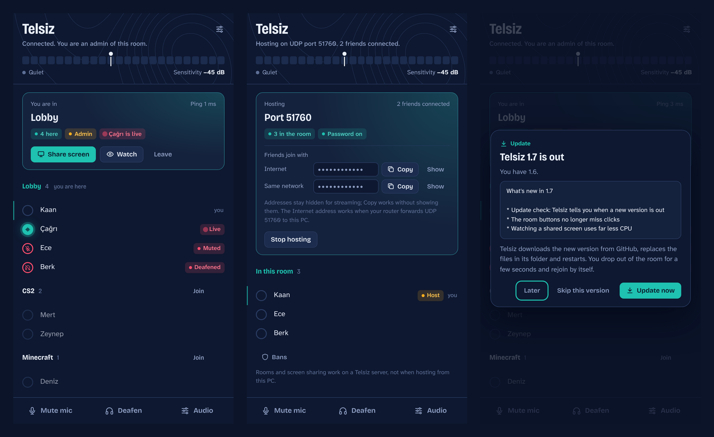
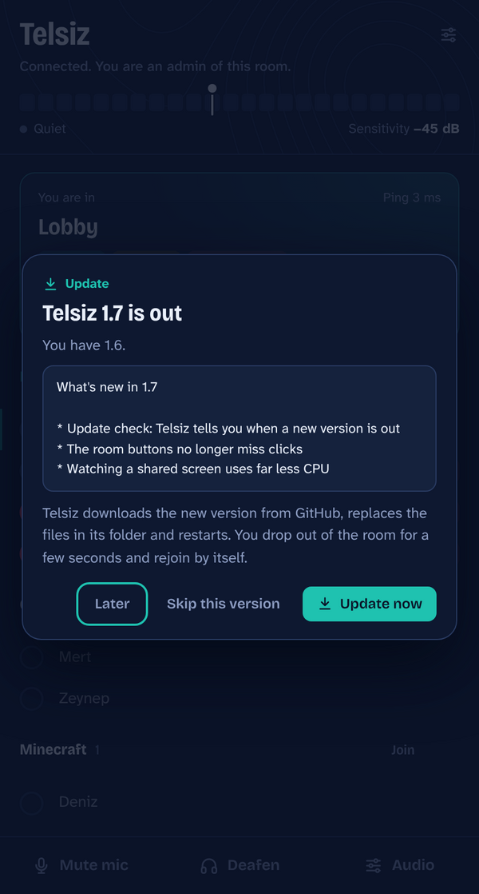
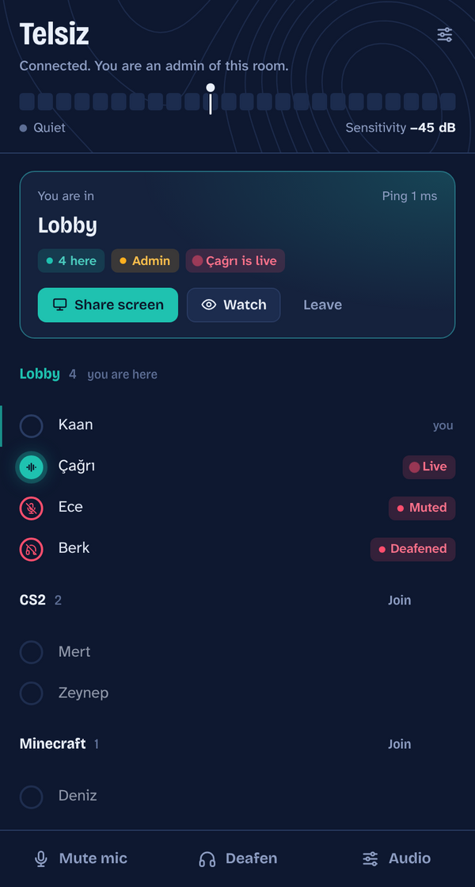
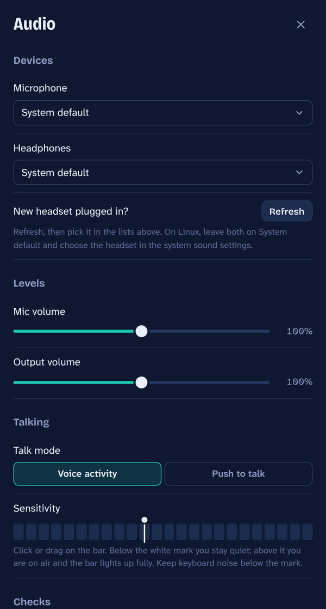
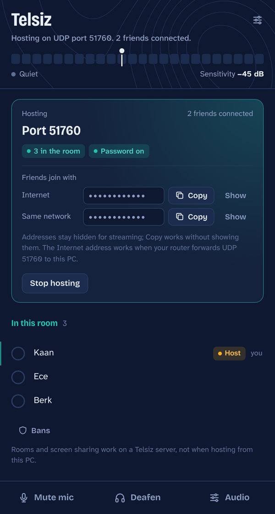
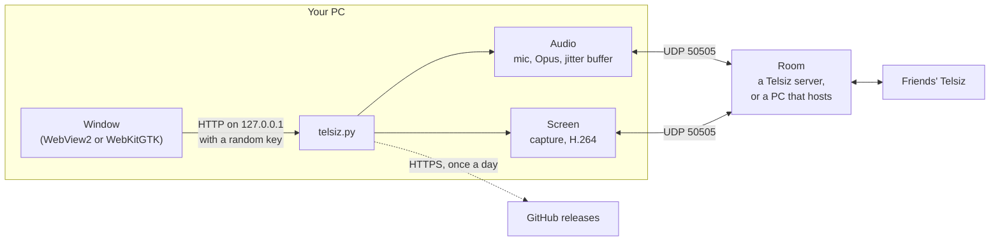

<p align="center">
  
</p>

<h1 align="center">Telsiz</h1>

<p align="center">
  Voice chat for a group of friends who play games together.<br>
  No accounts, no company in between: one PC hosts the room, or a five dollar server does, and everyone joins with an address and a password.
</p>

<p align="center"><b>Windows 10 and 11 · Linux</b> · version 1.6</p>



---

## Contents

1. [What Telsiz is](#1-what-telsiz-is)
2. [Highlights](#2-highlights)
3. [Requirements](#3-requirements)
4. [Installing](#4-installing)
5. [Updating](#5-updating)
6. [A tour of the window](#6-a-tour-of-the-window)
7. [Talking: voice activity and push to talk](#7-talking-voice-activity-and-push-to-talk)
8. [Rooms and screen sharing](#8-rooms-and-screen-sharing)
9. [Hosting on your PC](#9-hosting-on-your-pc)
10. [Running a Telsiz server](#10-running-a-telsiz-server)
11. [Kick, ban and admins](#11-kick-ban-and-admins)
12. [Streaming and privacy](#12-streaming-and-privacy)
13. [Settings and your data](#13-settings-and-your-data)
14. [Troubleshooting](#14-troubleshooting)
15. [Running and building from source](#15-running-and-building-from-source)
16. [Releasing a new version](#16-releasing-a-new-version)
17. [How it works inside](#17-how-it-works-inside)
18. [Bandwidth and limits](#18-bandwidth-and-limits)
19. [Credits and licences](#19-credits-and-licences)
20. [Changelog](#20-changelog)

---

## 1. What Telsiz is

*Telsiz* is Turkish for a two way radio. It is a small voice chat program written to replace Discord for one group of friends, and it does one job: let a handful of people talk while they play.

There are two ways to run a room:

* **Host on your PC.** One person presses **Start hosting** and the others join that PC's address. Nothing to rent, but the host's router has to let friends in (see [Hosting on your PC](#9-hosting-on-your-pc)).
* **Run a Telsiz server.** A tiny program on a rented Linux server (a VPS for about five dollars a month) holds the room. Everyone, the owner included, simply joins it. Nobody's home address is involved, and you also get **rooms** and **screen sharing** (see [Running a Telsiz server](#10-running-a-telsiz-server)).

There are no accounts, no text chat, no webcams and no telemetry. Apart from the voice room itself, Telsiz only ever contacts two places: `api.ipify.org`, to show a host their own Internet address, and GitHub, once a day, to see whether a newer version exists (you can switch that off).

---

## 2. Highlights

* **Clear, low latency voice.** Opus at 32 kbit/s (48 kHz, mono, 20 ms frames), an adaptive jitter buffer between 40 and 120 ms, and concealment of lost packets.
* **Voice activity or push to talk.** Drag a sensitivity mark on a live level bar, or hold any keyboard key or mouse side button. Optional chimes, which only you hear, tell you when you are on air.
* **The usual controls.** Microphone and headphone choice, mic and output volume, per person volume from 0 to 200%, Mute, Deafen, and a "hear myself" mic test.
* **You can see who is talking.** People's rings light up while they speak. Muted and deafened people are marked for everyone.
* **Rooms and screen sharing** on a Telsiz server: admins create and delete rooms, and anyone can share a screen (720p at 15 fps, or 1080p at 5 fps for text) to the people in their room who press Watch.
* **Kick and ban**, by device and by Internet address.
* **Safe to stream.** Addresses show as dots until you press Show, and Copy works without revealing them.
* **Stays out of the way.** On Windows, closing the window keeps Telsiz in the tray, and starting it a second time just brings the window back.
* **Updates itself** from GitHub releases, after asking you.
* **Small.** The app is one Python file plus a web page. The server is one Python file that needs nothing beyond Python's standard library.

---

## 3. Requirements

* **Windows 10 or 11**, 64 bit. The window is drawn by the **Microsoft Edge WebView2 Runtime**, which Windows 11 includes. On a PC without it, Telsiz opens in your web browser instead, works the same there, and tells you how to get WebView2.
* **or Linux** with GTK and WebKitGTK. `run_linux.sh` installs them on Ubuntu, Debian, Mint, Fedora, Arch and Manjaro. Tested on Ubuntu 24.04.
* **A microphone and headphones.** Use headphones rather than speakers: Telsiz has no echo cancellation.
* **To run from source:** Python 3.10 or newer (Telsiz is tested with 3.13 on Windows 11 and 3.12 on Ubuntu).
* **For a server:** the smallest VPS any provider sells, with Ubuntu 24.04 or Debian 12 (Python 3.8 or newer).
* **Network:** one UDP port, 50505 unless you choose another.

---

## 4. Installing

### Windows: Telsiz.exe (the easy way, and what to send friends)

1. Download **`Telsiz.exe`** from the [latest release](https://github.com/emirbgeo/Telsiz/releases/latest).
2. Put it in **a folder of its own that you can write to**, for example a `Telsiz` folder in Documents or on the Desktop. Not in `Program Files`: updates replace the exe where it is, and Windows doesn't let programs write there.
3. Double click it. Windows SmartScreen will warn you, because the file is not code signed: click **More info**, then **Run anyway**. The first start takes a few seconds while the exe unpacks itself.
4. The first time, **Audio settings** open by themselves. Pick your microphone and headphones and check the sensitivity (see [Talking](#7-talking-voice-activity-and-push-to-talk)).
5. Choose **Join a room**, type the **Address** and **Password** you were given, and press **Join**.

### Windows: from source

1. Install Python from [python.org](https://www.python.org/downloads/) and tick **Add python.exe to PATH** in the installer.
2. Get the code: the green **Code** button on GitHub, then **Download ZIP** (unpack it), or `git clone https://github.com/emirbgeo/Telsiz.git`.
3. Double click **`run_windows.bat`**. The first start creates a private Python environment in `.venv` and installs the libraries; later starts are instant. After an update it installs any new libraries by itself.

Manual alternative: `py -m pip install -r requirements.txt`, then `py telsiz.py`.

### Linux

```
git clone https://github.com/emirbgeo/Telsiz.git
cd Telsiz
bash run_linux.sh
```

(Downloading the ZIP works too.) The first run checks for GTK and WebKit with their Python bindings, the Python `venv` module and the PortAudio library, offers to install whatever is missing (apt, dnf or pacman), sets up `.venv`, and adds Telsiz to your applications menu. After that, start it from the menu.

How Linux differs:

* **Push to talk and Wayland.** Most desktops now default to Wayland. There, push to talk only notices your key while an X11 program has focus. Most Steam and Proton games are X11 programs; the desktop, browsers and other native Wayland apps are not. Use voice activity, or pick an X11 session ("Ubuntu on Xorg", "Plasma (X11)") on the login screen if you want push to talk everywhere.
* **Screen sharing needs an X11 session.** Under Wayland the capture sees nothing. Watching works everywhere.
* **No tray icon.** Closing the window quits Telsiz.
* **Sound devices.** The lists show raw ALSA entries. Leave both on **System default** and choose your headset in the system's sound settings.

macOS is untested: `pip install -r requirements.txt`, then `python3 telsiz.py`.

---

## 5. Updating

### What happens by itself

About eight seconds after it starts, and then once a day while it runs, Telsiz asks GitHub for the newest release of this repository. If that release is newer than the version you have, a dialog shows its notes and three choices:

<p align="center"></p>

* **Update now** installs it and restarts Telsiz (details below). If you were in a room, Telsiz rejoins it by itself after the restart; if you were hosting, it starts hosting again.
* **Later** closes the dialog. Telsiz asks again the next time it starts.
* **Skip this version** never asks about that version again. A newer one is offered as usual.

If Telsiz is in the tray when a new version appears, a Windows notification tells you. You can also look by hand at any time: **Audio** settings, **Updates**, **Check now**. Check now also shows versions you skipped. To stop the daily question, switch off **Check for updates** in the same place.

### What Update now does

It depends on how you run Telsiz:

| You run Telsiz as | Update now |
|---|---|
| **Telsiz.exe** | Downloads `Telsiz.exe` from the release and checks its size and, when GitHub lists one, its SHA 256 checksum. Windows lets a running program be renamed but not replaced, so Telsiz renames itself to `Telsiz.old.exe`, puts the new exe in its place and starts it. The old file is deleted on the next start. |
| **a downloaded folder** (run_windows.bat, run_linux.sh, `python telsiz.py`) | Downloads the release's source zip and checks it. If `requirements.txt` gained lines, it installs just those with pip. Then it replaces the files; if anything fails halfway, the files it already replaced are put back. Your `.venv` stays. |
| **a git clone** | Runs `git pull --ff-only`, which refuses rather than overwrite changes of your own, installs new libraries the same way, and restarts. |
| **from a folder Telsiz can't write to** (such as Program Files) | Opens the release page in your browser so you can download it yourself. |

Your settings live elsewhere (see [Settings and your data](#13-settings-and-your-data)) and are never touched by an update.

### Safety

* Nothing is installed until you press **Update now**.
* Telsiz only downloads over HTTPS from `github.com` and `githubusercontent.com`, and refuses any redirect to another address.
* The exe must match the size and checksum GitHub publishes for it, and must be a Windows program. A source zip is refused if any file name in it would land outside the Telsiz folder.
* The check sends nothing about you: one HTTPS request a day with `Telsiz/<version> (update check)` as its user agent. GitHub sees your Internet address, as any website you visit does.
* Everything rests on the GitHub account that publishes the releases. Whoever controls it can ship code to every Telsiz that says yes. The account must have **two factor authentication** switched on.

### Friends on 1.5 or older

Versions before 1.6 have no update check. Everyone needs to download 1.6 by hand once; from then on Telsiz offers updates itself.

---

## 6. A tour of the window

<p align="center">
  
  &nbsp;
  
</p>

**The top** shows the status line and the **level bar**: your microphone level, from blue for quiet to red for loud, with the white sensitivity mark on it. The bar lights up fully while you are on air. The slider icon opens Audio settings; on Windows a second icon hides Telsiz to the tray.

**The room card** changes with what you are doing:

* *Not connected:* choose **Host a room** or **Join a room**, your name, then the address and password (both hidden on screen, with **Remember address** and **Remember password** switches), and **Join** or **Start hosting**.
* *In a room:* the room's name, your ping, chips for how many people are here, **Admin** if you are one, and who is live. Buttons: **Share screen**, **Watch** (when someone in your room shares), **Leave**.
* *Hosting:* your port, how many people are in, whether a password is set, and **Friends join with**: the Internet and same network addresses, each with **Copy** and **Show**. **Stop hosting** closes the room.

**People** lists everyone. On a server, rooms are headings: point at one to get **Join**, and admins also get **Delete**. A person's ring lights up while they talk; labels show **Muted**, **Deafened** and **Live**. **Click a person** (or right click) for their volume slider and, when they apply, **Watch**, **Kick** and **Ban**. Below the list, hosts and admins find **New room** and **Bans**.

**The bottom bar** has **Mute mic**, **Deafen** and **Audio**.

**Audio settings** hold Devices (microphone, headphones, **Refresh** after plugging in a headset), Levels (mic and output volume, 0 to 200%), Talking (talk mode, push to talk key, the sensitivity bar), Checks (**Hear myself**, **Push to talk sounds**), Updates (**Check for updates**, **Check now**) and **Quit Telsiz**. Everything is saved as you change it.

Questions (kick, ban, delete a room), the share dialog, Bans and the update dialog all open inside the window. In yes or no questions the safe answer has the keyboard focus, so pressing Enter never kicks anyone.

---

## 7. Talking: voice activity and push to talk

### Voice activity (the default)

Telsiz sends your voice whenever your level is above the **sensitivity mark**. Drag the mark on the level bar, click where you want it, or use the arrow keys to move it 1 dB at a time. Speak normally and set it so your voice crosses the mark and your keyboard, fan and breathing don't. After you stop, Telsiz keeps sending for another 300 ms, so the ends of words aren't cut off.

### Push to talk

In **Audio**, set **Talk mode** to **Push to talk**, press **Set key**, then press the keyboard key or mouse side button you want. Telsiz sends only while you hold it, including while a game has focus.

* **Push to talk sounds:** a rising chime when you go on air and a falling one when you let go. Only you hear them. Switch them off in Audio.
* **Games running as administrator:** Windows hides key presses from programs that are not, so run Telsiz as administrator too.

### Mute, deafen and volumes

* **Mute mic** stops sending. **Deafen** silences everyone else and mutes you as well. Others see **Muted** or **Deafened** next to your name (on Telsiz servers 1.4 or newer and when the host runs 1.4 or newer).
* On Windows the tray icon's menu has Mute mic and Deafen too. The tray icon turns teal while you transmit and red while you are muted.
* **Per person volume:** click a person and drag their slider (0 to 200%). Telsiz remembers it by name.
* **Hear myself** plays your own microphone back to you, to check how you sound.

---

## 8. Rooms and screen sharing

Both need a Telsiz server (1.3 or newer). Hosting from a PC has one room and no screen sharing.

### Rooms

* Everyone starts in the **Lobby**. Admins create rooms with **New room** and remove them with **Delete**. Deleting a room moves its people to the Lobby, which can't be deleted. Up to 25 rooms.
* You only hear the people in your own room, but everyone sees all rooms and who is in each.
* Rooms are saved on the server and survive restarts. When you rejoin a server, Telsiz puts you back in the room you were in.

### Screen sharing

* Press **Share screen** in the room card, pick a screen and a quality, then **Start sharing**:
  * **Smooth:** 720p at 15 pictures per second, for games and videos.
  * **Sharp text:** 1080p at 5 pictures per second, for code and documents.
  * Both use at most 1.5 Mbit/s. A screen smaller than the chosen size is never enlarged.
* People in your room see **Live** next to your name and **Watch** in their room card. Watch opens your screen in its own window. Double click it for full screen; Esc leaves full screen.
* Only people who press Watch receive any video. One person per room shares at a time.
* The picture only: game and system sound are not shared. Your microphone works as usual.
* The server keeps the last few seconds of video, so a viewer who lost packets gets them again from the server instead of waiting for a whole new picture.
* **Things to know:** the whole screen is shared, pop ups and notifications included, so close anything private first. Games in exclusive full screen may share as a black picture: switch them to borderless or windowed. Protected video (streaming sites) shows black too. Sharing costs some CPU on the sharing PC.

---

## 9. Hosting on your PC

The host's PC must be reachable on one UDP port (default 50505). The first time you host, Windows Firewall asks for permission: allow it.

<p align="center"></p>

**Same home network.** Friends type the **Same network** address. Done.

**Over the internet, option A: port forwarding.** First rule out CGNAT, because it makes port forwarding impossible. Open your router's status page and find its WAN or PPPoE address. If it starts with `100.64` to `100.127`, or differs from the **Internet** address Telsiz shows, your ISP shares one public address among many customers, and nothing you do on your router will let friends in. Use option B, a Telsiz server, or ask your ISP for a public IPv4 address. If you do have a public address: forward **UDP** (not TCP) port 50505 to your PC's home address (the **Same network** one) and give friends the **Internet** address.

**Over the internet, option B: a virtual LAN.** Everyone installs the same tool (Tailscale, ZeroTier or Radmin VPN) and joins the same network. Friends then join the host's virtual address, which Telsiz lists under "Other addresses on this PC". No router changes, and it works behind CGNAT. Tailscale and ZeroTier also encrypt the traffic.

**Windows Firewall.** If you pressed Cancel at the firewall question, or only ticked "Private" while your network (or the virtual LAN adapter) counts as "Public", Windows creates block rules, and block rules win over allow rules. Run **`allow_firewall.bat`** once as administrator: it removes old Python and Telsiz inbound rules and opens UDP 50505 on every network type.

A PC hosts up to 15 guests. **Set a room password**, especially with a static IP: without one, anyone who learns your address can join and listen.

---

## 10. Running a Telsiz server

A Telsiz server is a room that lives on a rented Linux machine instead of your PC. It only passes packets along: it decodes nothing, needs no sound card, and used under 1% of one CPU core in testing, even relaying a screen share to three viewers. The full guide, with providers and prices, is **[server/SERVER.md](server/SERVER.md)**. In short:

1. Rent the smallest VPS with Ubuntu 24.04, close to your friends.
2. Copy the `server` folder to it and run `sudo sh install_server.sh`. The installer creates a user with no login so the server never runs as root, installs a service that restarts after crashes and reboots, opens the port in `ufw` if that firewall is on, and **prints two passwords**.
3. Join with the **admin password** yourself: it works as a room password and also gives you Kick, Ban, Bans and the room controls. Give friends the **room password**, never the admin one.

Updating the server straight from this repository:

```
rm -rf /root/telsiz-src && mkdir /root/telsiz-src
curl -fsSL https://github.com/emirbgeo/Telsiz/archive/refs/heads/main.tar.gz | tar xz -C /root/telsiz-src --strip-components=1
sh /root/telsiz-src/server/install_server.sh
```

Passwords, bans and rooms live in `/var/lib/telsiz` and survive updates. Never delete that folder unless you want new passwords.

Apps and servers of different versions work together: apps from 1.1 on can join newer servers and talk, and simply miss the newer features.

---

## 11. Kick, ban and admins

* **Who can:** the host when hosting from a PC; people who joined a server with its admin password.
* **Kick** removes someone for now. On a PC host they can't rejoin until the host stops and starts hosting again. On a server they stay out until everyone has left the room or the server restarts.
* **Ban** keeps them out across restarts until an admin unbans them under **Bans**. The Bans list shows names and dates, never addresses.
* Admins can't kick or ban each other.
* Both work on a random **device ID** that each Telsiz install creates for itself, and a ban also covers the person's Internet address. So someone sharing an Internet connection with a banned person (the same house) is blocked too, and a determined person can get around a ban by deleting their Telsiz settings and changing their Internet address. For a room of friends that is fine; it is not a defence against a determined attacker. The room password is.
* On a server, ten wrong passwords from one address within a minute make the server ignore that address for the rest of the minute, so passwords can't be guessed quickly.

---

## 12. Streaming and privacy

Telsiz was built by someone who streams.

* Addresses show as dots until you press **Show**; **Copy** works without revealing them. The join address field is hidden the same way. Status lines and error messages never contain an address.
* Everyone who joins your PC's room knows your Internet address, because they typed it. Hiding it only protects you from stream viewers. A Telsiz server avoids the problem completely: friends only ever see the server's address.
* Screen sharing shows your whole screen. Close private things before you share.
* Telsiz contacts `api.ipify.org` only while **Host a room** is selected (to show your Internet address) and GitHub once a day for updates. Nothing else leaves your PC except your voice and, if you share, your screen.

---

## 13. Settings and your data

* **Where:** `%APPDATA%\Telsiz\settings.json` on Windows, `~/.config/Telsiz/settings.json` on Linux.
* **What:** your name, devices, volumes and sensitivity, talk mode and push to talk key, per person volumes (by name), the bans you made as a PC host, this install's device ID, the last room you were in on each server (stored under a hash, so the address itself is not written down), and the update settings. With **Remember address** and **Remember password** switched on, the join address and password are stored too, **in plain text**. Switching them off also deletes what was stored.
* **Starting fresh:** quit Telsiz and delete the `Telsiz` settings folder. You get a new device ID, so kicks and bans tied to the old one no longer apply to you.
* **On a server:** settings and passwords are in `/var/lib/telsiz/server.json`, rooms in `/var/lib/telsiz/telsiz_rooms.json`, bans in `/var/lib/telsiz/telsiz_bans.json`.

---

## 14. Troubleshooting

**Telsiz doesn't start on Windows (no window, no message).** Telsiz.exe and `run_windows.bat` start without a console, so a crash before the window appears is silent. To see the error, open PowerShell in a Telsiz source folder (the exe runs the same code) and start it with a console: `py telsiz.py`. Whatever goes wrong is printed there. Version 1.5 crashed this way on Windows (see the [changelog](#20-changelog)); 1.6 fixes it.

**It opened in the web browser instead of its own window.** The window engine is missing: the WebView2 Runtime on Windows, WebKitGTK on Linux (which `run_linux.sh` installs). Everything works in the browser tab too. **Quit Telsiz** is in Audio settings, and on Windows also in the tray.

**"No answer from the host."** The message says which case applies: a home address used from outside the home, nothing listening at that address, or packets that never arrive (router rule, firewall, CGNAT). See [Hosting on your PC](#9-hosting-on-your-pc).

**Microphone or headphones error.** Pick another device in Audio settings and press **Refresh** (also needed after plugging in a new headset). If you have no microphone at all, **Got it** hides the warning.

**Choppy or robotic voice.** Usually the host's upload or someone's Wi Fi. A network cable fixes most of it.

**Push to talk does nothing in a game.** Run Telsiz as administrator if the game runs as administrator. On Linux, see the Wayland note in [Installing](#linux).

**A shared screen is black.** The game is in exclusive full screen (switch it to borderless), the video is protected, or the sharer is on Linux under Wayland.

**Update messages:**

| Message | What it means |
|---|---|
| GitHub is limiting update checks from this network right now | GitHub allows 60 anonymous requests per hour from one Internet address. Wait an hour. |
| No Telsiz release was found on GitHub | No release has been published yet, or the repository is private. |
| Could not reach GitHub | No internet, or a firewall blocks it. |
| The download was sent to an address outside GitHub | Refused on purpose. Try again later, or use Open download page. |
| The download was incomplete / is damaged | The file didn't arrive intact. Try again. |
| Installing the new libraries failed | pip couldn't install a new library. Its last line is shown. Run `run_windows.bat`, or `pip install -r requirements.txt`, and read the full message. |
| git pull failed | Your clone has changes of its own. Commit or stash them, then try again. |
| Windows refused to replace a Telsiz file | Another copy of Telsiz or a virus scanner held a file. Close other copies and try again. |
| Telsiz can't update itself here | It runs from a folder it can't write to, such as Program Files. Move Telsiz.exe to a folder of its own. |

---

## 15. Running and building from source

### Libraries

From `requirements.txt`: `numpy`, `sounddevice` (PortAudio), `av` (PyAV: Opus and H.264 through FFmpeg), `pynput` (push to talk), `pystray` and `Pillow` (tray icon), `mss` (screen capture) and `pywebview` (the window; on Windows it brings `pythonnet`).

```
py -m pip install -r requirements.txt      (Windows)
py telsiz.py
```

On Linux, use `run_linux.sh`: it installs the system parts pip can't (GTK, WebKit, PortAudio) and avoids building pynput's optional parts.

### Building Telsiz.exe

Double click **`build_windows.bat`**. It installs PyInstaller, draws the icon and builds **`dist\Telsiz.exe`**, a single file that carries Python, the codecs, the audio library and the window library (the web engine itself comes from Windows). It can't be code signed without a paid certificate, so SmartScreen warns about it.

### Project layout

```
telsiz.py             the app: audio, network, screen sharing, updater, and the controller behind the window
ui/                   the window: index.html, styles.css, app.js; viewer.html and viewer.js; fonts
server/               telsiz_server.py, install_server.sh, SERVER.md
run_windows.bat       start on Windows (creates .venv, installs libraries)
run_linux.sh          set up and start on Linux, add the menu entry
build_windows.bat     build dist\Telsiz.exe
allow_firewall.bat    fix Windows Firewall rules for hosting
requirements.txt      Python libraries
assets/, docs/        icon and the pictures in this README
```

### Switches for development

| Environment variable | Effect |
|---|---|
| `TELSIZ_HEADLESS=1` | No window: prints the page address and serves it, for tests and browsers. |
| `TELSIZ_PRINT_URL=1` | Also print the page address when the window opens. |
| `TELSIZ_UPDATE_URL` | Ask this address instead of GitHub for the latest release (a local test server). |
| `TELSIZ_UPDATE_DELAY` | Seconds before the first update check (default 8). |
| `TELSIZ_TRAY=1` | Try a tray icon outside Windows. |
| `TELSIZ_PYTHON` | The Python that `run_linux.sh` uses. |

---

## 16. Releasing a new version

This is how a new version reaches everyone's Telsiz. The update check reads only **published, non pre-release** GitHub releases, compares their **tag** with the version inside the program, and downloads the asset named **`Telsiz.exe`** for exe users.

1. In `telsiz.py`, raise **`APP_VERSION`**, for example from `"1.6"` to `"1.7"`. **It must match the tag in step 4.** (If a tag is ever higher than the program inside it, Telsiz installs it once and then skips that tag, rather than offering it every day.)
2. Add the changes to the [Changelog](#20-changelog).
3. Commit and push:
   ```
   git add -A
   git commit -m "Telsiz 1.7"
   git push
   ```
4. Build the exe with `build_windows.bat` and **test it on your PC and one friend's** before publishing.
5. On GitHub, open **Releases**, then **Draft a new release**:
   * **Choose a tag:** type `v1.7` and choose *Create new tag on publish*, target `main`.
   * **Release title:** `Telsiz 1.7`.
   * **Description:** what changed, in a few lines. Telsiz shows the first 3000 characters, as plain text, in the update dialog.
   * **Attach** `dist\Telsiz.exe`. The file name must be exactly `Telsiz.exe`.
   * Leave **Set as a pre-release** unticked (pre-releases and drafts are ignored), then **Publish release**.

   Or, with the GitHub CLI: `gh release create v1.7 dist\Telsiz.exe --title "Telsiz 1.7" --notes "What changed"`.
6. Every Telsiz 1.6 or newer offers the update within a day, or at once with **Check now**.

To test the updater itself against a real release: set `APP_VERSION` in a local copy to something lower, say `"1.5.9"`, start it, and it will offer the published version.

---

## 17. How it works inside



* **Audio.** PortAudio (through `sounddevice`) records 20 ms frames at 48 kHz. Voice activity or push to talk decides whether a frame is sent. Frames are encoded with Opus (through PyAV) and sent over UDP. On the way in, each person gets an adaptive jitter buffer (40 to 120 ms) and lost frames are concealed. Everyone is mixed with their own volume and played to your headphones.
* **The room.** Whoever holds the room, a PC that hosts or a Telsiz server, relays each speaker's packets to the others in the same room without decoding them. The protocol is plain UDP: join, welcome, voice, ping, roster, and messages for rooms, statuses, kicks and screen sharing. Join requests are padded to 256 bytes so a reply is never larger than the request, which keeps the server from being used to amplify floods.
* **Screen sharing.** `mss` captures the screen, x264 encodes it for low latency, and pictures travel in pieces of about 1150 bytes. The server keeps recent pieces, so a viewer can ask for lost ones again, and a viewer can ask for a full picture at any time.
* **The window** is a web page drawn by the system's web engine through pywebview. The page talks to `telsiz.py` over HTTP on `127.0.0.1` only, under a random key created at each start, and can only call a fixed list of actions. A web page in your normal browser, or another program, can't read Telsiz's state or press its buttons without that key.
* **One copy at a time.** The running copy listens on `127.0.0.1:47571`; a second start asks it to show its window and quits.
* **Updates.** See [Updating](#5-updating).

---

## 18. Bandwidth and limits

**Bandwidth.** Each person who is talking costs about 45 to 50 kbit/s for every listener. Whoever holds the room sends that to everyone else, so a PC host's upload is the bottleneck: six people with two talking at once is roughly 0.5 Mbit/s up. Nobody sends anything while silent. Screen sharing costs at most 1.5 Mbit/s per viewer.

**Limits.**

* **No encryption of its own.** Voice and video travel as plain UDP, and the room password is sent in plain text. The password keeps strangers out; it doesn't hide the audio. If that matters, use Tailscale or ZeroTier, which encrypt everything. Don't join as admin from public Wi Fi.
* **No noise suppression or echo cancellation.** Use headphones, and keep keyboard noise below the sensitivity mark or use push to talk.
* **IPv4 only.** Up to 15 guests on a PC host; a server takes 15 by default and up to 50 (`max_clients` in its settings file).
* **The tray icon is Windows only.** On Linux and macOS, closing the window quits Telsiz.

---

## 19. Credits and licences

* **Telsiz** itself: MIT licence, © Emir Balkan. See [LICENSE](LICENSE).
* **Fonts:** [Bricolage Grotesque](https://github.com/ateliertriay/bricolage) (© 2022 The Bricolage Grotesque Project Authors) and [Atkinson Hyperlegible Next](https://github.com/googlefonts/atkinson-hyperlegible-next) (© 2020 to 2024 The Atkinson Hyperlegible Next Project Authors), both under the SIL Open Font License 1.1. The full licence texts are in `ui/fonts`.
* **Libraries:** [NumPy](https://numpy.org) (BSD 3 Clause), [python-sounddevice](https://github.com/spatialaudio/python-sounddevice) (MIT) with [PortAudio](https://www.portaudio.com) (MIT), [PyAV](https://github.com/PyAV-Org/PyAV) (BSD 3 Clause) with FFmpeg, [pynput](https://github.com/moses-palmer/pynput) and [pystray](https://github.com/moses-palmer/pystray) (both LGPL v3), [Pillow](https://python-pillow.org) (MIT CMU), [python-mss](https://github.com/BoboTiG/python-mss) (MIT), [pywebview](https://pywebview.flowrl.com) (BSD 3 Clause), [Python.NET](https://pythonnet.github.io) and clr-loader (MIT).
* **A note on Telsiz.exe:** PyAV's ready made packages include an FFmpeg build with the x264 and x265 encoders, which are licensed under the GNU GPL, and [FFmpeg's own legal page](https://ffmpeg.org/legal.html) says the GPL then applies to all of that FFmpeg. Telsiz's MIT code is compatible with that, but whoever distributes the exe should know that it contains GPL software, whose terms require its source code to be available. Telsiz's source is this repository; the FFmpeg and x264 sources are published by their projects. This is a summary, not legal advice.

---

## 20. Changelog

### 1.6 (November 2026)

* **Update check.** Telsiz asks GitHub once a day for a newer release, shows its notes, and installs it on **Update now**: the exe swaps itself, a source folder replaces its files (and puts them back if anything fails), a git clone runs `git pull --ff-only`. Later, Skip this version, Check now, and a switch to turn the daily check off. After the restart Telsiz rejoins the room it was in.
* **Fixed: 1.5 never started on Windows.** It handed the window library a PNG icon, which the Windows engine rejects with an error that killed the process before any window appeared. Windows now takes the icon from the exe.
* **Fixed: about one click in eight on the room card was lost** (Share screen, Watch, Leave). The card was rebuilt every second to update the ping; now only the ping text changes.
* **Fixed: watching a share in a large window used most of a CPU core.** The picture was enlarged to the window's full pixel size before being handed to it; now the window scales it. Measured at 4K: 87% of a core before, 12% after, at the same 15 pictures per second.
* **Fixed: Got it on the audio problem card did nothing** while the problem lasted. It now hides the card until the problem changes.
* The project moved to GitHub, with this README, a licence, and server updates straight from the repository.

### 1.5

* New look in the FocusDock style: dark survey navy, faint contour lines that change every day, one colour scale (blue, teal, lime, amber, red) used only for meaning. The level bar is the centrepiece; people light up while they talk; dialogs open inside the window.
* The window became a web page drawn by the system's web engine (Edge WebView2 on Windows, WebKitGTK on Linux) through pywebview. Sound, network and screen sharing were unchanged.

### 1.4

* Muted and deafened marks next to names, visible to everyone (needs a 1.4 server or a 1.4 PC host). A taller People list that scrolls. The version in the window title. A note under People when rooms and screen sharing are unavailable.
* The server installer notices a nested upload and installs the right copy.

### 1.3

* **Rooms** and **screen sharing** on a Telsiz server, with resending of lost video from the server's recent memory. Telsiz puts you back in your last room.

### 1.2

* **The Telsiz server** (`server/`): a room on a Linux VPS, installed as a service, with admin tools in the app for whoever joins with the admin password.
* 1.2.1: Remember address and Remember password.
* 1.2.2: `run_linux.sh` for Linux.

### 1.1

* Kick and ban. Addresses hidden by default with Show and Copy. Closing to the tray on Windows. Push to talk chimes with an off switch.

### 1.0

* First version: host or join, voice activity and push to talk, microphone and headphone choice, sensitivity, volumes.
